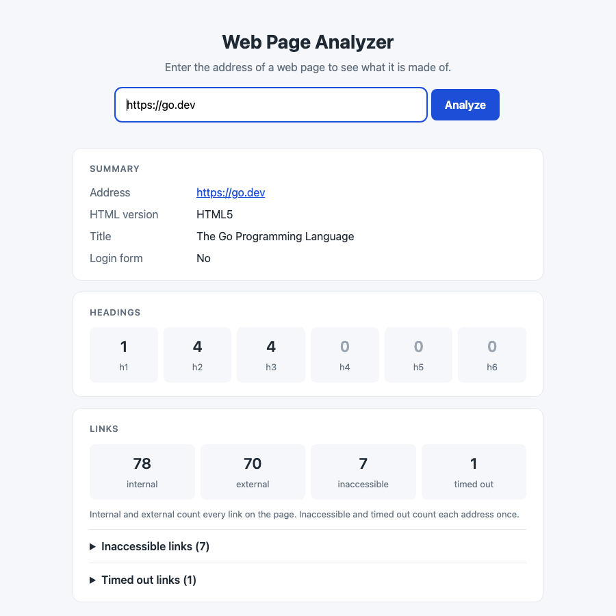
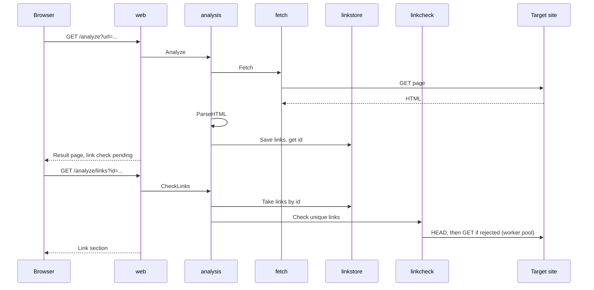
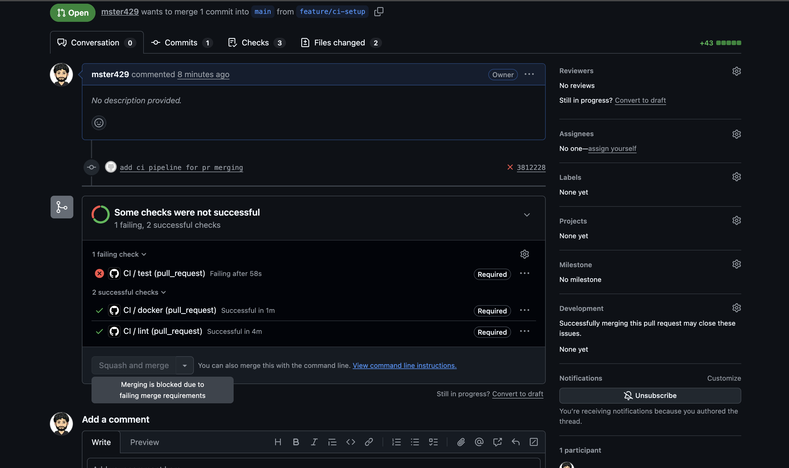

# Web Page Analyzer

A small web application written in Go that analyzes a web page. You enter the address of a page and it shows:

- the HTML version
- the page title
- how many headings there are at each level (h1 to h6)
- how many internal and external links there are
- which links are inaccessible, and which timed out
- whether the page has a login form

If the page cannot be reached, it shows the HTTP status code and a short description of what went wrong.



## Contents

- [Prerequisites](#prerequisites)
- [Setup and run](#setup-and-run)
- [Configuration](#configuration)
- [Routes](#routes)
- [Main functionality](#main-functionality)
- [Project structure](#project-structure)
- [Assumptions and decisions](#assumptions-and-decisions)
- [Testing](#testing)
- [Challenges](#challenges)
- [Limitations](#limitations)

## Prerequisites

You need one of these:

| To run with | You need |
|---|---|
| Go | [Go 1.27+](https://go.dev/dl/) and `make` |
| Docker | [Docker](https://docs.docker.com/get-docker/) with Compose 2.24+ |

There is no database and no other service to install. The Go dependencies are downloaded by the build. To run the
linter you also need [golangci-lint 2.x](https://golangci-lint.run/welcome/install/).

Built with Go's standard library (`net/http`, `html/template`) plus four modules, all fetched by the build:
[`x/net/html`](https://pkg.go.dev/golang.org/x/net/html) for parsing, [`zerolog`](https://github.com/rs/zerolog)
for logging, the [Prometheus client](https://github.com/prometheus/client_golang) for metrics and
[`golang-lru`](https://github.com/hashicorp/golang-lru) for the link store. Docker, Docker Compose and a Makefile
for building and running.

There is no separate frontend project: the Go server renders the HTML and serves it, together with the stylesheet,
from the same binary. There is no API specification or Swagger; the routes are listed below.

## Setup and run

```bash
git clone https://github.com/mster429/web-page-analyzer.git
cd web-page-analyzer
```

Then start it one of these ways. Each serves on port 8080.

```bash
make run                         # with Go

make build && ./bin/analyzer     # as a binary

make up                          # with Docker Compose (docker compose up --build)

make docker-run                  # with plain Docker
```

When it is ready the server logs one line:

```json
{"level":"info","addr":"[::]:8080","pprof":true,"time":"…","message":"server started"}
```

Open <http://localhost:8080>. Stop the server with `Ctrl+C`; requests still running are given time to finish.

`make help` lists all targets: `run`, `build`, `test`, `cover`, `lint`, `fmt`, `docker-build`, `docker-run`, `up`,
`down`, `clean`.

## Configuration

The application runs without any configuration. Every setting is an environment variable with a default, and
[`.env.example`](.env.example) describes each one.

| Variable | Default | Meaning |
|---|---|---|
| `HOST_PORT` | `:8080` | address the server listens on |
| `PAGE_FETCH_TIMEOUT` | `10s` | time allowed to download the page |
| `SINGLE_LINK_CHECK_TIMEOUT` | `5s` | time allowed for one link before it counts as timed out |
| `TOTAL_LINK_CHECK_TIMEOUT` | `20s` | time allowed to check all the links of a page |
| `LINK_CHECK_WORKERS` | `20` | how many links are checked at the same time |
| `PAGE_SIZE_LIMIT_MB` | `5` | how much of a page is read |
| `ENABLE_PPROF` | `true` | serve Go profiling data at `/debug/pprof/` |
| `LOG_LEVEL` | `info` | `debug`, `info`, `warn` or `error` |

To change settings, copy the example file. `make run` and Docker Compose both read `.env` when it exists:

```bash
cp .env.example .env
```

Or pass them for a single run. With `make` they go after the target:

```bash
make run LOG_LEVEL=debug PAGE_FETCH_TIMEOUT=3s
HOST_PORT=:9090 ./bin/analyzer
docker run --rm -p 8080:8080 -e LOG_LEVEL=debug web-page-analyzer:latest
```

An invalid value, such as `LINK_CHECK_WORKERS=many`, stops the application at startup with a message that names
the variable.

## Routes

| Route | Purpose |
|---|---|
| `GET /` | the form |
| `GET /analyze?url=…` | analyzes the page and shows the result, or the error page |
| `GET /analyze/links?id=…` | checks the links of an analyzed page and returns the link section as HTML |
| `GET /static/style.css` | the stylesheet |
| `GET /health` | answers 200 while the server is up |
| `GET /metrics` | Prometheus metrics |
| `GET /debug/pprof/` | Go profiling, unless `ENABLE_PPROF=false` |

## Main functionality



- **Analysis:** the page is downloaded once and parsed for the HTML version, title, headings, login form and links.
- **Link check:** runs in a second request so the page appears at once. A pool of worker goroutines checks each
  unique link, with a time limit per link and for the whole check.
- **Error handling:** a failed fetch returns a `FetchError` with the status code and a sentence for the user.
- **Logging:** JSON lines on stdout, one per request, plus a warning with the cause when a fetch fails.
- **Metrics and profiling:** Prometheus metrics at `/metrics`, pprof at `/debug/pprof/`.
- **Graceful shutdown:** running requests get up to 35 seconds to finish.
- **CI:** lint, tests and the Docker build run on every pull request to `main`.
- **Authentication:** none; the application has no users.

What the error page shows:

| Situation | Shown |
|---|---|
| The address is not an `http` or `https` URL | 400 Bad Request |
| The page answers with an error | the page's own status, for example 404 Not Found |
| Unknown host, refused connection, invalid certificate | 502 Bad Gateway, with the cause |
| The page does not answer in time | 504 Gateway Timeout |
| The address is not a web page (PDF, image, JSON) | 415 Unsupported Media Type |
| Anything unexpected | 500 Internal Server Error |

**Why 502 for an unknown host.** HTTP has no "no such host" code: the site never answered, so there is no status
of its own to show. The app is acting as a gateway, so it uses the gateway codes: 502 when the site can't be
reached, 504 when it times out. The description gives the real cause. A status the site did send (404, 503) is
shown as it is.


## Project structure

```
cmd/server/main.go            starts the application and sets the exit code
internal/app/                 builds everything, defines the routes, serves and shuts down
internal/config/              settings from environment variables
internal/analysis/            the core: result types, HTML parsing, the analysis service
internal/adapter/fetch/       downloads the page
internal/adapter/linkcheck/   worker pool that checks links
internal/adapter/linkstore/   keeps a page's links in memory between the two requests
internal/adapter/web/         handlers, template, stylesheet, request log and metrics
```

## Assumptions and decisions

The submitted address

- It must be a full address with an `http` or `https` scheme and a host. `example.com` alone is rejected.
- Redirects are followed, and the result shows the final address.
- A page that answers with status 400 or higher is not analyzed.

Links

- Only `<a href>` counts as a link. `mailto:`, `tel:`, `javascript:` and similar are skipped.
- A link is internal when it has the same host as the page, ignoring upper and lower case, the port and a leading
  `www.`. Any other subdomain is external.
- The `#fragment` is dropped, so `/docs#install` and `/docs#usage` are the same address.
- Internal and external count every link on the page. Inaccessible and timed out count each address once, because
  an address is only requested once.

Checking links

- Inaccessible means the link answered with status 400 or higher, or could not be connected to.
- Timed out is shown separately, since a slow site is not necessarily a broken one.
- When the time for the whole check runs out, the page says how many links were not checked.

Other

- A login form has exactly one password field. Two usually means a sign-up or change-password form.
- The form uses GET, so a result has an address that can be bookmarked.
- The standard library is used where it is enough; the dependencies are kept to four.

## Testing

```bash
make test     # unit tests with the race detector
make cover    # the same, with the total coverage
make lint     # golangci-lint
```

Total statement coverage is 95.6%.

| Package | Coverage | What is tested |
|---|---|---|
| `internal/analysis` | 98.1% | the parser with HTML strings as input, and the service with a fake fetcher, checker and store |
| `internal/adapter/fetch` | 100% | status codes, content types, the size limit, redirects, and each kind of failure |
| `internal/adapter/linkcheck` | 100% | outcomes per link, `HEAD` then `GET`, the worker limit, stopping when time runs out |
| `internal/adapter/linkstore` | 100% | save and fetch, single use, expiry, dropping the oldest entry when full |
| `internal/adapter/web` | 97.1% | every page and error page, the link section, request metrics and log, panic recovery |
| `internal/config` | 100% | defaults, every variable, and each invalid value |
| `internal/app` | 93.5% | the routes, and starting and stopping the server |

No unit test makes a real HTTP request. The fetcher and the link checker are given a fake `http.RoundTripper`,
so requests never leave the process, and the handlers are called directly with `httptest.NewRecorder`. The one
test that opens a port, for graceful shutdown, listens on a free local port and sends nothing to it.

There are no integration tests yet. The plan is to put them behind a build tag (`-tags integration`) and run the
whole application against an `httptest.Server` serving fixture pages, as a fourth CI job.

### Continuous integration

Every pull request to `main` runs three checks in GitHub Actions
([`.github/workflows/ci.yml`](.github/workflows/ci.yml)):

| Check | What it does |
|---|---|
| `lint` | runs `golangci-lint` with the settings in `.golangci.yml` |
| `test` | runs the unit tests with the race detector, and fails when total coverage is below 70% |
| `docker` | builds the Docker image |

**The `test` check needs at least 70% unit test coverage to pass.** It measures the total statement coverage of
all packages, the same number `make cover` prints, and fails the pull request when it is lower.

`main` is protected: all three checks are required, so a pull request cannot be merged while one of them fails.
The screenshot shows a pull request blocked by a failing `test` check.



## Challenges

**A page with many links made the whole result slow.** At first one request did everything, so a page with a few
hundred links kept the browser waiting for up to 30 seconds before showing anything. I split the work in two: the
first response shows what parsing gives, and the link check runs in a second request started by the page.

**Carrying the links from the first request to the second.** Fetching the page twice would be wasteful and the two
copies could differ. I keep the links in a small in-memory cache with a size limit and a two-minute expiry, behind
an interface so it can be replaced. An id works once, and an unknown or expired id gives a clear message.

**Working links reported as broken.** Some servers answer `HEAD` with 403 or 405 for pages that open normally.
The checker now retries with `GET` when `HEAD` is answered with an error.

**Which status code to show when a page gives no answer.** A page that answers 404 has a status to show, but an
unknown host or a timeout has none. I show the page's own status when there is one, and otherwise 502, or 504
for a timeout, with the actual cause in the description.

**Results that looked right but were not.** A PDF or an image was parsed as an empty web page. The fetcher now
checks the content type and reports it as an error.

**The same page showing its failed links in a different order each time.** The workers finish in no fixed order,
so the lists are sorted before they are shown.

**Shutting down without cutting off a running analysis.** Docker kills a container 10 seconds after asking it to
stop, which is shorter than a slow link check. I raised the shutdown timeout in the application and the grace
period in Docker Compose together.

## Limitations

- JavaScript is not executed, so pages built in the browser can show few headings, few links and no login form.
- Private and local addresses are not refused. On a public deployment that is a server-side request forgery risk.
- The links wait in memory, so only one instance of the application can run, and a restart loses pending checks.
- **Some links are reported as inaccessible although they open in a browser.** The checker only sees the status
  code a site answers with, and there are three common reasons it differs from what a person sees:
  - *Bot protection.* Sites behind Cloudflare and similar services (Medium, Stack Overflow and X, for example)
    tell a real browser from a program by how the connection itself is made, and by a JavaScript check that
    only a browser can run. They answer 403 Forbidden to everything else, whatever headers are sent.
  - *Login or rate limits.* A page that needs a login answers 401 or 403, and a site that thinks it is getting
    too many requests answers 429. A browser that is logged in, or that only made one request, gets the page.
  - *Friendly error pages.* Some sites show a normal-looking page for an address that no longer exists, but
    answer 404 Not Found with it. In that case "inaccessible" is correct.

- A page larger than `PAGE_SIZE_LIMIT_MB` is analyzed up to that limit without notice.
- Pages are assumed to be UTF-8, and `<base href>` is not honoured.
- `/metrics` and `/debug/pprof/` are on the public port and have no authentication.
